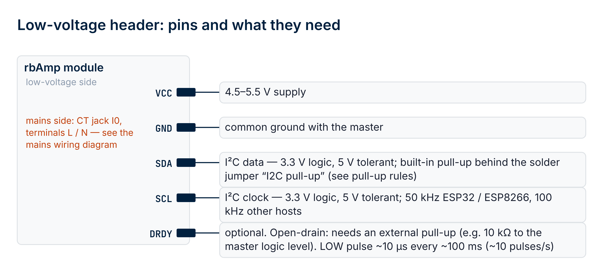
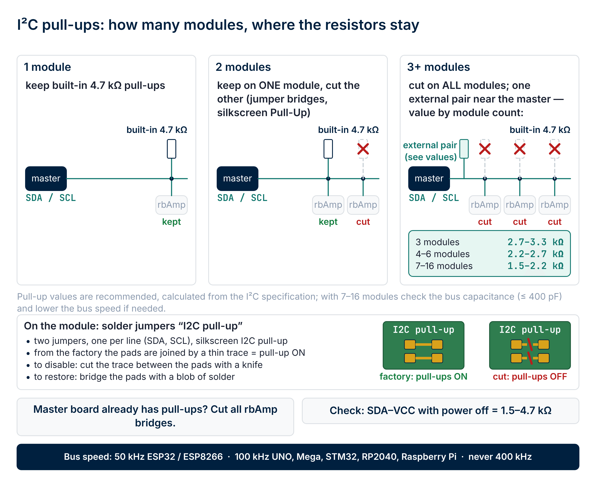
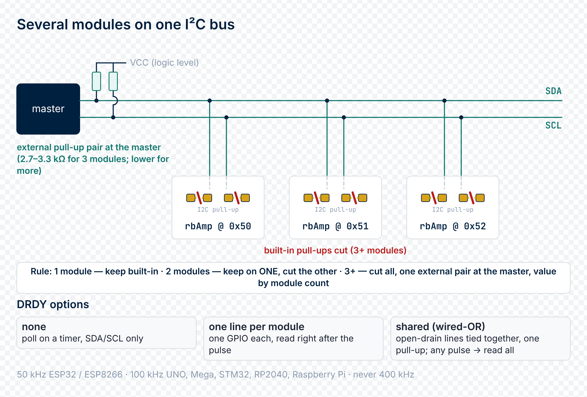
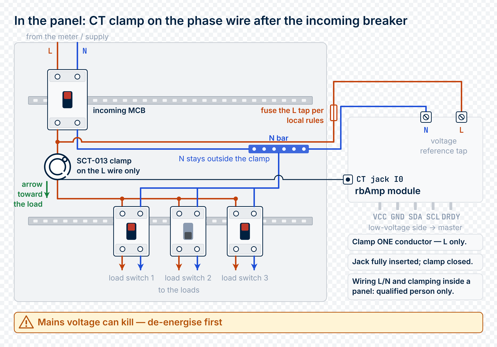
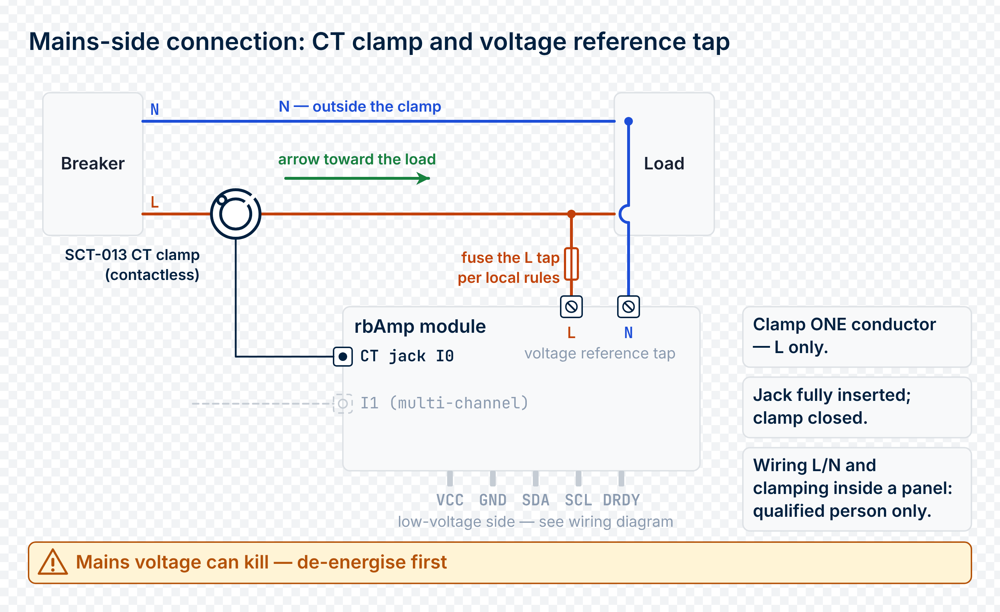
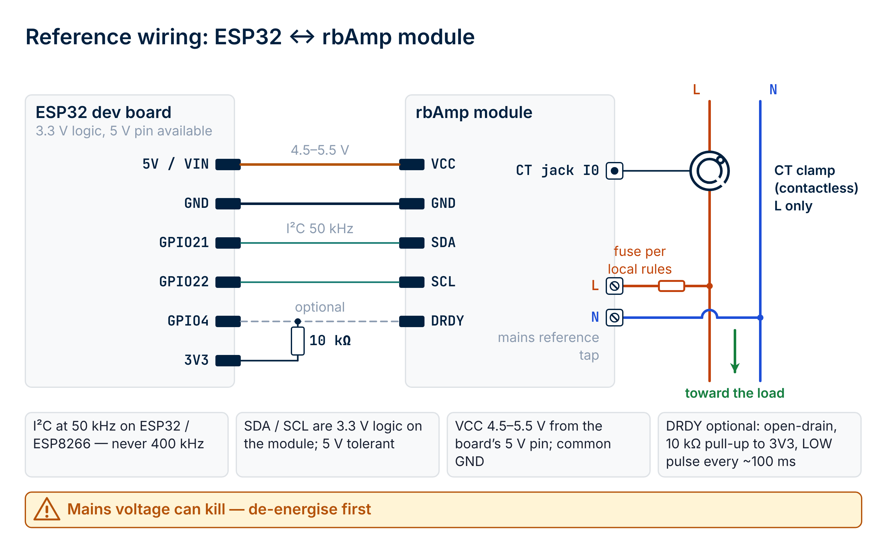

# 01 · Hardware Connection

This chapter describes the physical connection of rbAmp to a master device and the power requirements. The module arrives ready to operate: everything on its mains side is wired up and isolated inside the enclosure. The user works only with the low-voltage (LV) side — four wires for I2C, an optional DRDY line, and (for SKUs with an external CT) a 3.5 mm jack for the clamp.

> ⚠ **Mains side — read before installing.** Disconnect and lock out the circuit before connecting
> the `L`/`N` terminals or fitting the clamp. Wiring `L`/`N`, and clamping a conductor inside a
> panel, must be done by a qualified person. Fuse the `L` tap per local rules. Clamp **one**
> conductor only (`L`) — never the whole cable. The sensor clamp is contactless, but it needs a
> conductor with intact insulation.

## LV-side pinout

The module runs on 3.3 V logic and is tolerant to 5 V logic on the I2C lines. All LV-side pins are fully galvanically isolated from mains.

| rbAmp pin | Signal | Function |
|---|---|---|
| `VCC` | +4.5 … +5.5 V (power) | Module power; minimum 4.5 V required for correct operation |
| `GND` | Ground | Common ground with master — **mandatory** |
| `SDA` | I2C SDA | I2C data |
| `SCL` | I2C SCL | I2C clock |
| `DRDY` | Data-ready (optional) | Open-drain LOW pulse ~10 µs every measurement window (~100 ms on current firmware) |

---

## I2C pull-ups — installed on the board

**Important**: each rbAmp module has built-in 4.7 kΩ pull-up resistors on SDA and SCL to 3.3 V. For a **single-module** bus, no external pull-ups are required — connect the master directly.

### When to disable the built-in pull-ups

If several rbAmp modules (or other I2C devices with their own pull-ups) are on the bus, their parallel combination yields too low an effective resistance, which:

- Increases bus power consumption
- Can exceed the maximum sink current of the I2C-master output stage (typically ≤ 3 mA on 3.3 V logic)
- Adds capacitive load on long buses, while contributing little to noise immunity

Solution: each module has **solder-jumper cuts** on the bottom of the PCB next to the pull-up resistors. The silkscreen reads `Pull-Up`. Cut the trace with a sharp blade to disconnect the pull-up:

- Leave the pull-ups enabled on **only one** module on the bus (or relocate them to a single point near the master).
- Cut the jumpers on the remaining modules.
- If the master board already provides bus pull-ups, cut the jumpers on **all** rbAmp modules.

---

### Rule of thumb

| rbAmp modules on bus | Pull-ups |
|:---:|---|
| 1 | Leave alone (built-in 4.7 kΩ work) |
| 2 | Leave on one module, cut on the other |
| 3 | Cut on all modules, install one external pair of **2.7…3.3 kΩ** near the master |
| 4…6 | Cut on all modules, external pair **2.2…2.7 kΩ** near the master |
| 7…16 | Cut on all modules, external pair **1.5…2.2 kΩ** near the master; check the total bus capacitance (≤ 400 pF) and lower the bus speed if needed |

> These are **recommended values** calculated from the I²C specification (pull-up sink current ≤ 3 mA at 3.3 V, bus capacitance ≤ 400 pF) — not a measured guarantee for every cable and master. Connect the external pull-ups to **3.3 V** (the logic level of the bus), not to the 5 V `VCC` supply. A 5 V master: see *I2C voltage compatibility* below.

> **In doubt**: measure the resistance between SDA and VCC with all devices unpowered. For a single-module bus the typical value is ~4.7 kΩ (one built-in pull-up); on a multi-module bus the parallel combination drops to the **1.5–4.7 kΩ** range depending on how many built-in pull-ups remain active. Anything below ~1 kΩ means too many active pull-ups in parallel — cut the built-in pull-ups on all but one module.

---

## Power

### VCC parameters

- **Nominal voltage**: 5 V DC
- **Acceptable range**: 4.5 … 5.5 V
- **Current draw**: ~15 mA typical, ~25 mA peak during flash write
- **Ripple**: < 50 mV peak-to-peak (for measurement accuracy)

> ⚠ **Observe supply polarity.** Reverse polarity on the 5 V input is **not supported** — check the
> VCC/GND wiring before power-up. Double-check the wiring colour convention of your harness before
> first power-on, especially when crimping your own cables.

---

### I2C voltage compatibility

- SDA/SCL run on 3.3 V logic (the built-in pull-ups tie them to 3.3 V).
- The lines are **5 V-tolerant**, so a 5 V master (Arduino UNO / Nano) reads HIGH (~3.3 V) correctly and can drive the bus.
- Standard setup: pull-ups to 3.3 V. Only if you deliberately want 5 V bus levels, disable the built-in pull-ups and add external pull-ups to +5 V on the master side.

---

### Power-on behavior

- Cold start: ~250 ms to the first valid measurement result.
- After RESET (software or brown-out): ~250 ms to recover.
- Before the first valid result, registers read 0 and `DATA_VALID` (`0xCE`) is 0.

---

### Isolation

The module contains a galvanic isolation barrier between the mains side (CT clamp, voltage divider) and the LV side (I2C). Consequently:

- The module's GND is **not** connected to mains phase or neutral.
- Connecting the LV side to a 5 V master is safe — no short-circuit risk through ground.

> Do not open the enclosure — it will void factory calibration.

---

## I2C bus

### Parameters

- **Default address**: `0x50` (7-bit)
- **Address range**: `0x08..0x77` (reprovisionable via two-phase commit, see [02_initialization.md](initialization.md))
- **Speed**: **50 kHz recommended** (lowest NACK rate observed across host stacks). 100 kHz workable with application-level retry. 400 kHz is **not** validated for v1.3.
- **READ auto-increment**: **YES** — burst-read supported (multi-byte registers, V03 RT block, DIGEST window).
- **WRITE auto-increment**: **NO** — every byte written needs an explicit register address, including multi-byte fields (write low byte, then high byte separately).
- **Clock-stretching**: not used by the module as a flow-control mechanism. The master should observe an inter-transaction gap (`tBUF`) of ≥ 100 µs.

---

### Bus length

I2C is, by default, a short bus (~15 cm). Many users connect modules with low-quality jumper wires, which pick up a lot of noise and lose many transfers — hence the short limit. Recommended topologies for rbAmp:

| Cable topology | Max length | Speed |
|---|---|---|
| Standard JST / 4-wire flat cable | up to 0.15 m | 100 kHz |
| Twisted pair UTP (cat-5/5e/6) — SDA+GND and SCL+GND in separate pairs | up to 1 m | 100 kHz |
| Twisted pair UTP + I2C buffer (PCA9515 / TCA9617) | up to 3 m | 100 kHz |
| Differential bus (PCA9615 / LTC4332) | up to 100 m | 100 kHz |

> The lengths above are given for 100 kHz; the **50 kHz recommendation** (§Parameters) applies to
> every topology — the lower speed only adds margin.

> For runs longer than 0.15 m, **twisted pair is required**: SDA and SCL must be in **separate** pairs, each with its own ground (for example, blue + blue-white for SDA, green + green-white for SCL). Putting SDA and SCL in the same pair causes cross-coupling that distorts edges.

> ⚠ **Inside an electrical cabinet, shield the I2C cable.** Strong magnetic fields near mains conductors, contactors and transformers induce noise in an unshielded cable. Keep the cable as short as possible and away from the mains wiring.

---

### Multi-module bus

Multiple rbAmp modules can share a single I2C bus:

- **Module count**: up to ~16 (limited by total bus capacitance — ≤ 400 pF at 100 kHz)
- **Addresses**: every module has its own 7-bit address. All modules ship from the factory on `0x50`; readdress them one at a time before connecting in parallel (see [02_initialization.md → Address change](initialization.md)).
- **Pull-ups**: follow the module-count table above (recommended values) — with 3+ modules cut the built-in pull-ups on all of them and use one external pair sized for the module count.

---

## Sensor connections (mains side)

### Voltage sensor (UI* variants)

The PCB exposes `L` (line / phase) and `N` (neutral) terminals. **Polarity matters** for the sign of active power:

- Correct wiring (L → L, N → N): `P > 0` means **consumption** (current flowing into the load from the grid), `P < 0` means **export** to the grid (generation).
- Swapped wiring (L and N exchanged): the sign of P is inverted — consumption is reported as negative power.

**Wire and fuse.** A thick wire is not required for the voltage connection: AWG26–22 is enough, because the voltage sensor draws very little current. A fuse in the L line is **mandatory**, rated up to 0.1 A.

Correct polarity is critical for:

- Accurate BASIC-tier accounting (BASIC counts only `max(P, 0)`; swapped polarity zeros out the energy total).
- Correct separation of consumption and generation on the STANDARD (STD) tier.

> **Quick check**: with a purely resistive load (electric kettle, heater, incandescent bulb), `P > 0` and `PF ≈ 1.0`. If P is negative while the load is consuming, de-energise the circuit first, then swap L and N on the PCB.

---

### Current sensor — CT and SCT-013 (for SKUs with external CT)

External CT clamps connect to the module through a 3.5 mm jack. The connector is keyed for correct polarity out of the box; no wiring decisions are needed. Characteristics of each SCT-013 rating (floors, class, tolerance, clipping): see the [SCT-013 table](overview.md#current-channel-accuracy-with-sct-013-sensors).

The clamp body bears an **arrow** indicating the direction of energy flow for the "normal" orientation:

Rules:

- Clamp the sensor around the **line (L) wire** going to the consumer.
- The arrow on the clamp must point **in the direction of current** toward the load (from breaker panel to load).
- The clamp must **close completely** — no gap between the two halves of the magnetic core. A gap > 0.1 mm sharply increases magnetic reluctance and degrades accuracy.

> ⚠️ **Warning**: do not pass both L and N through the same clamp. Their magnetic fluxes are equal and opposite, so they cancel — the sensor reads near zero current even under real load.

#### Channel markings on the PCB

Each jack on the PCB is labeled with the channel name (`I0`, `I1`, `I2`, …) and a color marker. SCT-013 cables are electrically symmetric — orientation is established by **the arrow on the clamp** and its placement on the wire, not by which end of the cable goes into the jack.

#### Polarity and the sign of P

- Arrow in the correct direction + correct L/N polarity → `P > 0` for consumption, `P < 0` for export.
- Clamp installed reversed (arrow against current direction) → the sign of P is inverted.

---

## DATA_READY (DRDY)

Optional pin for optimized polling. If your application is happy polling on its own fixed interval (100 ms or slower), you can leave DRDY disconnected.

### Electrical parameters

- **Output type**: open-drain (no active pull-up to VCC)
- **Idle level**: HIGH (requires a pull-up on the master side — either an internal MCU pull-up or an external resistor; recommended 10 kΩ to 3.3 V)
- **Ready pulse**: LOW for ~10 µs, after RT registers (`0x86..0xCF`) have been refreshed
- **Pulse frequency**: ~10 Hz (one pulse per ~100 ms RT window; ~5 Hz on images before v1.2)

---

### Semantics

The falling edge of DRDY guarantees that **all RT registers are coherent and freshly published** (the firmware updates them atomically inside an ISR before lowering the pin). The master can read `0x86..0xCD` immediately on the falling edge with no risk of a split sample.

---

### Master-side usage

- **EXTI / GPIO interrupt** on the falling edge — wakes the master and triggers a read.
- Use **any input-capable GPIO** — the pin numbers in the examples (e.g. GPIO 15) are illustrative, not a requirement.
- Pull-up 10 kΩ to 3.3 V on the master side.
- Multiple module DRDYs can be combined into a wired-OR (see [03_realtime_polling.md → Multi-module DRDY](realtime-polling.md)).

---

### Applicability

- DRDY fires only on **RT updates** (every measurement window, ~100 ms on current firmware).
- DRDY does **not** fire on period snapshots (period snapshots are updated by the snapshot command which the master triggers — so the master already knows when to read).
- For slow-polling masters (every 1 s or 60 s), DRDY can be ignored.

> **In the client libraries** — the same task without register access:
>
> | Library | Call | What it does |
> |---|---|---|
> | Arduino | [`RbAmp::setDrdyPin(pin)`](https://github.com/rb-amp/rbamp-arduino/blob/main/docs/09_api_reference.md#bool-setdrdypinint-pin-noexcept) / [`RbAmp::waitDataReady(timeout_ms, ev)`](https://github.com/rb-amp/rbamp-arduino/blob/main/docs/09_api_reference.md#bool-waitdatareadyuint32_t-timeout_ms-rbampdrdyevent-ev--nullptr-noexcept) | attach the DRDY pin; wait for the next published window |
> | ESP-IDF | [`rbamp_set_drdy_gpio()`](https://github.com/rb-amp/rbamp-esp-idf/blob/main/docs/09_api_reference.md#data-ready-drdy) / [`rbamp_wait_data_ready()`](https://github.com/rb-amp/rbamp-esp-idf/blob/main/docs/09_api_reference.md#data-ready-drdy) | attach the DRDY pin; wait for the next published window |
> | Python | — | the library does not use the DRDY pin |
> | ESPHome | [`drdy_pin:`](https://github.com/rb-amp/rbamp-esphome/blob/main/docs/09_api_reference.md#drdy_pin) | optional DRDY input; only logged, not used as a read trigger |

---

## Reference wiring example (ESP32, single module)

In this configuration:

- External I2C pull-ups are NOT needed (built into the module).
- 10K on DRDY is the required external pull-up.
- The SCT-013 jack is fully inserted.
- The clamp is fully closed on the L wire, arrow pointing toward the load.

---

## Other module variants

Other module variants use the same LV-side pinout (VCC / GND / SDA / SCL / DRDY); only the mains side differs.

---

## Next

- [02_initialization.md](initialization.md) — first connection, smoke test, address change
- [05_troubleshooting.md → CT clamp & polarity](troubleshooting.md) — what to do if the sign of P is wrong or I_rms is unstable
