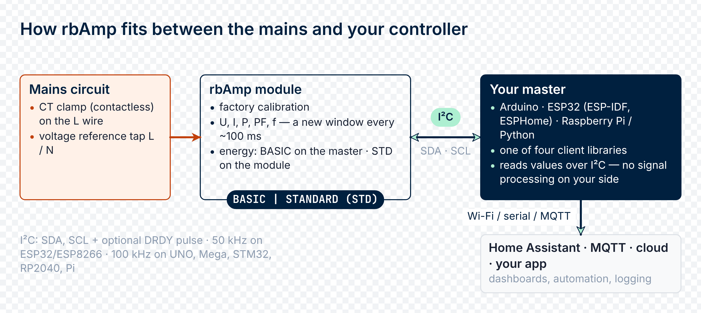

# 00 · Overview

## What is rbAmp

**rbAmp** is a compact hardware module for precision measurement of AC mains parameters over an I2C interface. It ships with factory-stored calibration.

From the integrator's point of view, rbAmp behaves like a standard I2C slave: apply power, read registers — receive ready-to-use physical-unit values (volts, amperes, watts). No signal processing is required on the master side.

## What it measures

The two module lines report the same quantities in different formats. BASIC returns floating-point values in base units; STANDARD (STD) returns scaled integers and adds more quantities, 8 independent period latches and on-module energy counters.

| Quantity | BASIC | STANDARD (STD) |
|---|---|---|
| RMS voltage, U_rms | float32, V | i32, mV (each voltage input has its own value) |
| Peak voltage, U_peak | float32, V | i32, mV |
| RMS current, I_rms | float32, A | i32, µA |
| Peak current, I_peak | float32, A | i32, µA |
| Active power, P | float32, W, signed | i32, mW, signed |
| Apparent power, S | — | i32, mVA |
| Reactive power, Q | float32, var, unsigned (≥ 0) | i32, mvar, signed |
| Reactive power of the fundamental, Q1 | — | i32, mvar (option) |
| Power factor, PF | float32, −1…+1 | i16, step 1/1024 ≈ 0.001, −1…+1 |
| Power factor of the fundamental, PF1 | — | i16, step 1/1024 (option) |
| Line frequency | u8, Hz: 50 or 60 (detected, not measured) | u16, 0.01 Hz steps, measured |
| Voltage and current THD | — | u16, 0.01 % steps (option) |
| Voltage phase angle | — | i16, 0.01° steps (modules with several voltage inputs) |
| Average power over a period | float32, W; one latch (average and peak P) | 8 independent latches: import/export energy, average U/I/P/Q, peaks |
| Energy | not kept on the module — the host (library) integrates it | on the module: import/export in Wh / mWh / µWh, reactive in varh / µvarh; kept when the power is off |

Accuracy is not part of this table: for BASIC with an SCT-013 sensor see the next section; specifications of individual modules are given with the model descriptions. The BASIC register map is in [03_realtime_polling.md](realtime-polling.md), [04_period_metering.md](period-metering.md) and [11_api_reference.md](api-reference.md); the STD register map is in the [STD technical reference](std/reference/README.md).

### Current-channel accuracy with SCT-013 sensors

**BASIC modules (SCT-UI series) with your own SCT-013 sensor — resistive load, measured at 50 Hz.**
(Modules with a factory-paired CT sensor, and STD modules, are specified separately — this table does not apply to them.)

| Characteristic | SCT-013-005 | SCT-013-010 | SCT-013-020 | SCT-013-030 | SCT-013-050 | SCT-013-060 | SCT-013-100 |
|---|---|---|---|---|---|---|---|
| Detectable floor (the reading with no load) | ~3 mA | 6–9 mA | ~10 mA | ~13 mA | ~25 mA | ~30 mA | ~60 mA |
| Readable floor (error ≤ 10 %; 0.5 % of rating) | 25 mA | 50 mA | 0.10 A | 0.15 A | 0.25 A | 0.30 A | 0.50 A |
| Class near the floor, UI1 / UI2 / UI3 (UI3 when available; ±1 % of the average, from ~0.7 % of rating) | from 35 mA | from 70 mA | from 0.14 A | from 0.21 A | from 0.35 A | from 0.42 A | from 0.70 A |
| Class near the floor, UI5 / UI7 (when available; ±0.5 %, from 2 % of rating) | from 0.10 A | from 0.20 A | from 0.40 A | from 0.60 A | from 1.0 A | from 1.2 A | from 2.0 A |
| Class in the working range (5–100 % of rating, of the average) | ≤ 0.5 % | 0.16–0.35 % | ≤ 0.5 % | 0.53 % | ≤ 0.5 % | ≤ 0.5 % | 0.47 % |
| Tolerance of the sensor unit (added on top of the class) | ≤ 0.8 % | 0.5–1.0 % | 0.8 % | 1.2 % | 0.7 % | 0.3–0.4 % | 0.45 % |
| Step of one instantaneous value | 4.1 mA | 8.1 mA | 16 mA | 24 mA | 41 mA | 49 mA | 83 mA |
| Top of the range (clipping, sine wave) | ~6.0 A | 11.9 A | ~24 A | 35 A | ~60 A | ~72 A | ~117 A |

**Source:** verified in multiple bench laboratory tests. Note that real SCT-013 sensors have an actual error of about 1 %, and it can grow with time or with temperature. If you need good measurement quality at small currents, choose a sensor with a smaller rating.

- **Step of one instantaneous value** is about 0.08 % of the rating. The RMS reading is computed over the whole 100 ms window and returned as a fractional number, so it is finer than the step: for example, with the 5 A sensor the no-load reading is ~3 mA although the step is 4.1 mA. The real resolution is limited by noise, not by the step.
- **Near the floor:** a single reading (one 100 ms window) at 1 % of the rating is noisy by 0.6–2 %. The average over a period and the energy stay within the class shown in the table.
- **UI5 / UI7 below 2 % of the rating:** the spread between modules is up to ±5 %, so for these modules the class near the floor starts at 2 % of the rating.
- "Average" = the average of several 100 ms measurement windows, as used for energy and average power.
- Clipping is a property of the SCT-013 sensor (its output level at rated current); stay below the rating for reliable readings.
- Changing the sensor model is writing the model code to the module — no recalibration step.

## Applications

- **Tariff metering** — energy billing in 1-min, 15-min, 1-hour, daily, monthly, or yearly intervals
- **Smart home** — whole-house consumption monitoring, per-load sub-metering, generation tracking
- **Load control** — feedback signal for power-regulating devices (water heaters, resistive loads, inverters)
- **Energy balancing** — separate accounting of consumption and generation in homes with solar
- **Grid quality monitoring** — both on the consumer side and on the utility side

## Module variants

| Variant | U | I channels | P | Status | When to choose |
|---|:---:|:---:|:---:|---|---|
| **UI1** | yes | 1 | yes | shipping | single accounting point — whole-house meter, boiler, single inverter |
| **UI2** | yes | 2 | yes | shipping | two sub-meters on one phase (lights + outlets, generation + consumption) |
| **UI3** | yes | 3 | yes | not yet available | three flows on one phase |
| **UI5 / UI7** | yes | 5 / 7 | yes | not yet available | high-channel-count phase monitoring (large panels, lab benches) |
| **I1** | no | 1 | no | shipping | current-only monitor (master computes P with its own U source) |
| **I2** | no | 2 | no | shipping | two-channel current monitor |
| **I3** | no | 3 | no | shipping | three-channel current monitor |

> On I-only variants, active power is not computed (`P_real = 0`), and `PERIOD_AVG_P_W` returns 0. The master must either provide its own voltage source for power calculation, or use the current data alone.

## Product tiers

rbAmp is offered in two product tiers. Each tier is a complete combination of **hardware revision and firmware** — not a firmware-only flag. Moving between tiers requires a physical SKU change, not a firmware update.

### BASIC — entry-level product line

- **Hardware**: cost-optimized analog front-end suitable for typical residential loads.
- **Firmware**: unidirectional consumption metering. The per-period accumulator clamps each per-window active-power sample to zero before integrating: only positive (consumed) energy is counted, mirroring a classical mechanical disc meter that only spins forward.
- **`PERIOD_AVG_P_W` is always ≥ 0**; reverse-flow events are dropped from the period accumulator.
- **Use cases**: households without on-site generation; sub-metering of pure consumers (heaters, motors, appliances).

### STANDARD — bidirectional product line

- **Hardware**: extended analog stack supporting accurate measurement of both consumption and reverse flow.
- **Firmware**: bidirectional metering with signed on-device energy. Bidirectional products belong to the **rbAmp STD line**, which uses a different, 16-bit register map — see the STD reference documentation.
- **Use cases**: homes with rooftop solar, wind generators, battery storage, regenerative loads, V2G EV chargers.

### Where the tier shows up in this documentation

Throughout the chapters, features that depend on the tier are explicitly marked, for example:

> **STANDARD (STD) only** — on a BASIC module this register is not available.

The BASIC 8-bit register map (`0x00..0xCF`) is what this documentation describes. STANDARD (STD) modules use a **different, 16-bit register map** — see the STD reference documentation.

## Key features

- **I²C slave**: recommended 50 kHz; workable at 100 kHz with application-level retry. 400 kHz is **not** validated for v1.3.
- **Address**: 7-bit `0x50` by default, reprovisionable to the `0x08..0x77` range via two-phase commit (see [02_initialization.md](initialization.md)).
- **DATA_READY (DRDY)**: optional open-drain pin, ~10 µs LOW pulse every measurement window (~100 ms on current firmware; 200 ms before v1.2), marks the moment when RT registers are coherent.
- **Atomic period latch**: command `0x27` freezes the per-period averaged power; *one write closes and opens* — no dropped or duplicated samples at the boundary.
- **General-Call broadcast latch**: address `0x00` reserved for simultaneous LATCH on all modules sharing a bus. **Opt-in per module** via `FLEET_CONFIG.bit0` (default OFF). When OFF, GC frame NACKs at the bus level — masters detect this and fall back to per-module sequential latch (skew on 50 kHz bus is ~1 ms × N, ≪ 0.03% of 60 s period). See [04_period_metering.md](period-metering.md) for enable sequence and frame format.
- **Master-side wall-clock**: energy is computed master-side as `avg_P × dt_master`; the chip-side period timestamp register (`0xEC`) is **diagnostic-only** (can undercount up to ~30% under load — by design). Eliminates per-module crystal drift in multi-module systems.
- **Calibration in flash**: factory calibration (gains, noise floor, phase compensation) is stored on-chip; **no user calibration is required** — the master only writes `SENSOR_CLASS` and `CT_MODEL` per channel.
- **Auto-configuration**: the module starts measuring immediately after power-on (~250 ms to the first valid result, ~700 ms additional for first persistence write).

## What rbAmp does not do

- Does not integrate energy (Wh) internally — energy accumulation is the master's responsibility (see [04_period_metering.md](period-metering.md))
- Does not drive loads, contain automation logic, or run programmable rules
- Has no built-in display

## Next

- [01_hardware.md](hardware-connection.md) — connection, power, wiring
- [02_initialization.md](initialization.md) — first power-on
