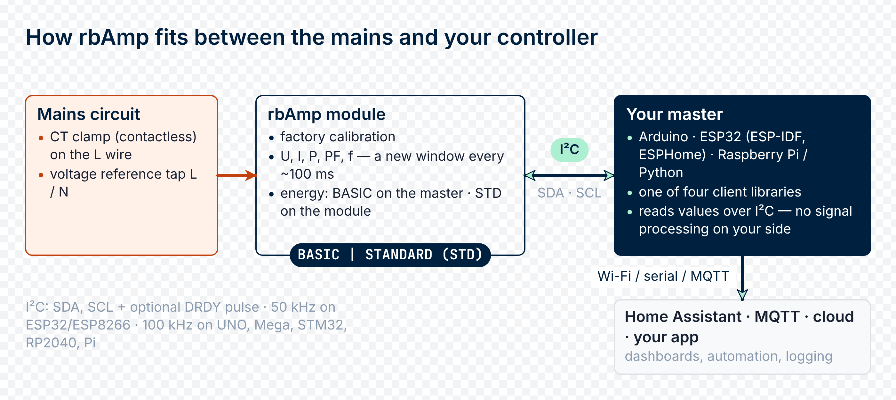
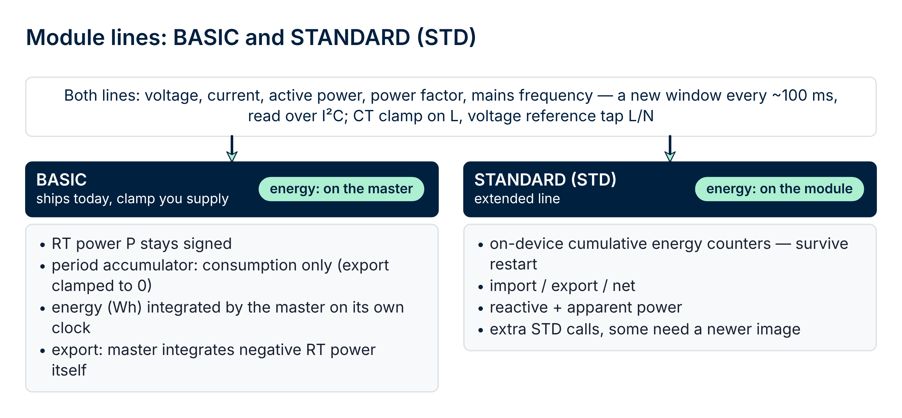

# 00 · Overview

## What is rbAmp

**rbAmp** is a compact hardware module for measurement of AC mains parameters over an I2C interface. It ships with factory-stored calibration.

From the integrator's point of view, rbAmp behaves like a standard I2C slave: apply power, read registers — receive ready-to-use physical-unit values (volts, amperes, watts). No signal processing is required on the master side.

---

## What it measures

BASIC reports the quantities below as floating-point values in base units. The STD line reports its quantities, with on-module energy counters, in the [STD documentation](std/overview.md).

| Quantity | BASIC |
|---|---|
| RMS voltage, U_rms | float32, V |
| Peak voltage, U_peak | float32, V |
| RMS current, I_rms | float32, A |
| Peak current, I_peak | float32, A |
| Active power, P | float32, W, signed |
| Reactive power, Q | float32, var, unsigned (≥ 0) |
| Power factor, PF | float32, −1…+1 |
| Line frequency | u8, Hz: 50 or 60 (detected, not measured) |
| Average power over a period | float32, W; one snapshot (average and peak P) |
| Energy | not kept on the module — the host (library) integrates it |

Accuracy is not part of this table: for BASIC with an SCT-013 sensor see the [SCT-013 characteristics table](#current-channel-accuracy-with-sct-013-sensors) below; specifications of individual modules are given with the model descriptions. The BASIC register map is in [realtime-polling.md](realtime-polling.md), [period-metering.md](period-metering.md) and [api-reference.md](api-reference.md).

### Current-channel accuracy with SCT-013 sensors

**BASIC modules (SCT-UI series) with your own SCT-013 sensor — resistive load, measured at 50 Hz.**
(Modules with a factory-paired CT sensor, and STD modules, are specified separately — this table does not apply to them.)

| Characteristic | SCT-013-005 | SCT-013-010 | SCT-013-020 | SCT-013-030 | SCT-013-050 | SCT-013-060 | SCT-013-100 |
|---|---|---|---|---|---|---|---|
| Detectable floor (the reading with no load) | ~3 mA | 6–9 mA | ~10 mA | ~13 mA | ~25 mA | ~30 mA | ~60 mA |
| Readable floor (error ≤ 10 %; 0.5 % of rating) | 25 mA | 50 mA | 0.10 A | 0.15 A | 0.25 A | 0.30 A | 0.50 A |
| Class near the floor, UI1 / UI2 / UI3 (±1 % of the average, from ~0.7 % of rating) | from 35 mA | from 70 mA | from 0.14 A | from 0.21 A | from 0.35 A | from 0.42 A | from 0.70 A |
| Class near the floor, UI5 / UI7 (±0.5 %, from 2 % of rating) | from 0.10 A | from 0.20 A | from 0.40 A | from 0.60 A | from 1.0 A | from 1.2 A | from 2.0 A |
| Class in the working range (5–100 % of rating, of the average) | ≤ 0.5 % | 0.16–0.35 % | ≤ 0.5 % | 0.53 % | ≤ 0.5 % | ≤ 0.5 % | 0.47 % |
| Tolerance of the sensor unit (added on top of the class) | ≤ 0.8 % | 0.5–1.0 % | 0.8 % | 1.2 % | 0.7 % | 0.3–0.4 % | 0.45 % |
| Step of one instantaneous value | 4.1 mA | 8.1 mA | 16 mA | 24 mA | 41 mA | 49 mA | 83 mA |
| Top of the range (clipping, sine wave) | ~6.0 A | 11.9 A | ~24 A | 35 A | ~60 A | ~72 A | ~117 A |

**Source:** verified in multiple bench laboratory tests. Note that real SCT-013 sensors have an actual error of about 1 %, and it can grow with time or with temperature. If you need good measurement quality at small currents, choose a sensor with a smaller rating.

- **Step of one instantaneous value** is about 0.08 % of the rating. The RMS reading is computed over the whole 100 ms window and returned as a fractional number, so it is finer than the step: for example, with the 5 A sensor the no-load reading is ~3 mA although the step is 4.1 mA. The real resolution is limited by noise, not by the step.
- **Near the floor:** a single reading (one 100 ms window) at 1 % of the rating is noisy by 0.6–2 %. The average over a period and the energy stay within the class shown in the table.
- **UI5 / UI7 below 2 % of the rating:** the spread between modules is up to ±5 %, so for these modules the class near the floor starts at 2 % of the rating.
- "Average" = the average of several 100 ms measurement windows, as used for energy and average power.
- Clipping is a property of the SCT-013 sensor (its output level at rated current); stay below the rating for reliable readings.
- Changing the sensor model is writing the model code to the module — no recalibration step.

---

## Applications

- **Tariff metering** — energy accounting in 1-min, 15-min, 1-hour, daily, monthly, or yearly intervals
- **Smart home** — whole-house consumption monitoring, per-load sub-metering, generation tracking
- **Load control** — feedback signal for power-regulating devices (water heaters, resistive loads, inverters)
- **Energy balancing** — separate accounting of consumption and generation in homes with solar
- **Grid quality monitoring** — both on the consumer side and on the utility side

---

## Module variants

Current BASIC product line: **SCT-UI1, SCT-UI2, SCT-UI3, SCT-UI5, SCT-UI7, SCT-I1, SCT-I2, SCT-I3**. In the code, **UI***n* means one voltage input and *n* current channels; **I***n* means *n* current channels only. The modules are supplied without a sensor; characteristics for each SCT-013 rating are in the [SCT-013 table](#current-channel-accuracy-with-sct-013-sensors). Other module lines have a different composition; a table for each line will be added here as it goes on sale.

**BASIC — for SCT-013 type sensors**

| Module | U | I channels | P | When to choose |
|---|:---:|:---:|:---:|---|
| **SCT-UI1** | yes | 1 | yes | single accounting point — whole-house meter, boiler, single inverter |
| **SCT-UI2** | yes | 2 | yes | two sub-meters on one phase (lights + outlets, generation + consumption) |
| **SCT-UI3** | yes | 3 | yes | three flows on one phase |
| **SCT-UI5 / SCT-UI7** | yes | 5 / 7 | yes | high-channel-count phase monitoring (large panels, lab benches) |
| **SCT-I1** | no | 1 | no | current-only monitor (master computes P with its own U source) |
| **SCT-I2** | no | 2 | no | two-channel current monitor |
| **SCT-I3** | no | 3 | no | three-channel current monitor |

**BASIC — with factory-paired CT clamps (CT series)**

| Module | U | I channels | P | When to choose |
|---|:---:|:---:|:---:|---|
| **CT-UI1** | yes | 1 | yes | one measuring point with a ready, calibrated clamp |
| **CT-UI2** | yes | 2 | yes | two sub-meters on one phase |
| **CT-UI3** | yes | 3 | yes | three flows on one phase |
| **CT-UI5 / CT-UI7** | yes | 5 / 7 | yes | high-channel-count per-phase metering |

A CT-series module is delivered with a current clamp on every channel. The clamp and the channel are calibrated together at the factory and marked with the channel number: there is nothing to select or configure. Clamp ratings are 1, 5, 10, 20, 30, 50 or 100 A. The voltage input is the same as on the SCT series. See [CT-series modules: start-up without configuration](initialization.md#ct-series-modules-start-up-without-configuration).

> On I-only variants, active power is not computed (`P_real = 0`), and `PERIOD_AVG_P_W` returns 0. The master must either provide its own voltage source for power calculation, or use the current data alone.

---

## Product tiers

rbAmp is offered in two product tiers. Each tier is a complete combination of **hardware revision and firmware** — not a firmware-only flag. Moving between tiers requires a physical SKU change, not a firmware update.

### BASIC — entry-level product line

- **Hardware**: cost-optimized analog front-end suitable for typical residential loads.
- **Firmware**: unidirectional consumption metering. The per-period accumulator clamps each per-window active-power sample to zero before integrating: only positive (consumed) energy is counted, mirroring a classical mechanical disc meter that only spins forward.
- **`PERIOD_AVG_P_W` is always ≥ 0**; reverse-flow events are dropped from the period accumulator.
- **Use cases**: households without on-site generation; sub-metering of pure consumers (heaters, motors, appliances).

---

### STD — a separate product line

STD is a separate product line: single- and three-phase modules with energy counters on the module and Modbus RTU. It has its own register map and its own documentation — see the [STD documentation](std/overview.md).

---

### Where the tier shows up in this documentation

This documentation describes the BASIC 8-bit register map (`0x00..0xCF`). STD modules use a **different, 16-bit register map** and are documented in the [STD documentation](std/overview.md); on STD these functions work differently.

---

## Key features

- **I²C slave**: 50 kHz on ESP32 and ESP8266 hosts (ESP-IDF driver limitation), 100 kHz on other hosts; 400 kHz is not recommended.
- **Address**: 7-bit `0x50` by default, reprovisionable to the `0x08..0x77` range via two-phase commit (see [initialization.md](initialization.md)).
- **DATA_READY (DRDY)**: optional open-drain pin, ~10 µs LOW pulse every measurement window (~100 ms on current firmware; 200 ms before v1.2), marks the moment when RT registers are coherent.
- **Atomic period snapshot**: command `0x27` freezes the per-period averaged power; *one write closes and opens* — no dropped or duplicated samples at the boundary.
- **General-Call broadcast snapshot**: address `0x00` reserved for simultaneous snapshot on all modules sharing a bus. **Opt-in per module** via `FLEET_CONFIG.bit0` (default OFF). When OFF, GC frame NACKs at the bus level — masters detect this and fall back to per-module sequential snapshot (skew on 50 kHz bus is ~1 ms × N, ≪ 0.03% of 60 s period). See [period-metering.md](period-metering.md) for enable sequence and frame format.
- **Master-side wall-clock**: energy is computed master-side as `avg_P × dt_master`; the chip-side period timestamp register (`0xEC`) is **diagnostic-only** (can undercount up to ~30% under load — by design). Eliminates per-module crystal drift in multi-module systems.
- **Calibration in flash**: factory calibration is stored on the module; **no user calibration is required**. On BASIC SCT-series modules the master writes only `SENSOR_CLASS` and `CT_MODEL` per channel for the connected SCT-013 sensor. On CT-series modules the host writes nothing — see [start-up without configuration](initialization.md#ct-series-modules-start-up-without-configuration).
- **Auto-configuration**: the module starts measuring immediately after power-on (~250 ms to the first valid result, ~700 ms additional for first persistence write).

---

## What rbAmp does not do

- Does not integrate energy (Wh) internally — energy accumulation is the master's responsibility (see [period-metering.md](period-metering.md))
- Does not drive loads, contain automation logic, or run programmable rules
- Has no built-in display

---

## Next

- [hardware-connection.md](hardware-connection.md) — connection, power, wiring
- [initialization.md](initialization.md) — first power-on
