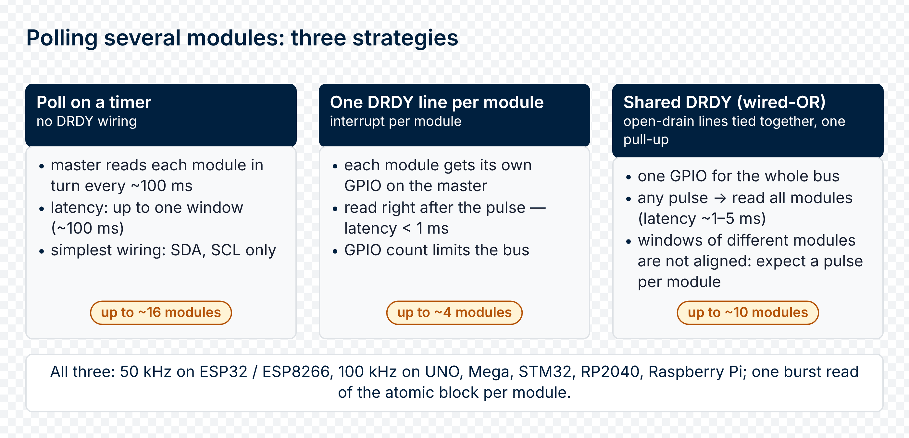

# 03 · Real-Time Polling

Real-time polling — reading instantaneous values of U, I, P, PF, flow direction, and related metrics at regular intervals (typically once per measurement window, ~100 ms). It is used for:

- Live dashboards (current power, voltage)
- Threshold alarms
- Event detection (load turn-on / turn-off)
- Mains-quality monitoring (frequency, PF)
- **Determining current direction — consumption or export** (from the sign of P_real)

For **tariff energy accumulation** (Wh over a period) use the period-snapshot mechanism described in [04_period_metering.md](period-metering.md).

---

## The measurement window (100 ms)


---

### What it is

The module measures continuously and publishes a result set every ~100 ms
(firmware images before v1.2: every ~200 ms):

- RMS of voltage and currents
- Peak values of U and I
- Active power P, computed as `mean(u(t) · i(t))` — **signed**, with the sign indicating flow direction:
  - `P > 0` — the load consumes from the grid (normal mode)
  - `P < 0` — the load exports to the grid (solar inverter, regenerative load)
- Reactive power Q, computed as `√(S² − P²)` with `S = U_rms × I_rms` — **unsigned** (≥ 0), includes distortion power; reads 0 on I-only variants and is noisy near PF ≈ 1
- Power factor PF = P / S, with S = U_rms × I_rms. The sign of PF matches that of P — an additional indicator of flow direction.

After computing a window, the firmware **atomically** publishes the entire result set (50+ bytes) into the I2C register block `0x86..0xCD`.

---

### Window length is fixed

The window is **hard-coded to 100 ms** on current firmware, independent of mains frequency. On images before v1.2 the window is 200 ms.

At 50 Hz mains a 100 ms window covers exactly 5 cycles; at 60 Hz, 6 cycles (10 and 12 on the older 200 ms window). In both cases the integer number of mains cycles keeps RMS and P accurate.

> The register `V03_PERIOD_MS` (`0xCA..0xCD`, u32 LE) reports the duration of the **current snapshot period** so far (ms since the last `CMD_LATCH_PERIOD` — see chapter 04). It is diagnostic only; it does not affect measurement accuracy or the energy calculation.

---

### When the next window starts

Immediately after the previous one is published. There is no gap between windows — measurement is continuous.


---

## DATA_READY (DRDY) — the ready pin

DRDY is an open-drain output pulled up to 3.3 V on the master side. The firmware drives it LOW for ~10 µs **after** the RT registers have been refreshed — a hardware signal that says "data is ready to read".

---

### Pulse parameters

- LOW duration: ~10 µs (comfortable for any master with EXTI)
- Frequency: ~10 Hz (one pulse per 100 ms window; ~5 Hz on images before v1.2)
- Output type: open-drain (supports wired-OR in multi-module topologies)
- Semantics: **the falling edge guarantees all RT registers are coherent and up to date**

---

### When DRDY is not needed

- The master polls slower than the window rate (once per second or minute) — data is refreshed ten times a second on current firmware, so any read picks up fresh data.
- A trivial polling loop — `read_rt()` can be called any time; you get the latest committed result.

---

### When DRDY is useful

- The master wants to minimise I2C traffic or free up CPU for other tasks (battery-powered systems)
- Precise synchronisation: read the exact moment of measurement completion (useful for high-resolution logs)
- Event detection: react to every window (e.g. instantaneous-power tracking at ~100 ms granularity)

---

### Usage (Arduino, one module)

```cpp
const uint8_t PIN_DRDY = 15;   // example pin — any input-capable GPIO works
volatile bool data_ready = false;

void on_drdy_falling() {
  data_ready = true;
}

void setup() {
  Serial.begin(115200);
  Wire.begin();
  pinMode(PIN_DRDY, INPUT_PULLUP);
  attachInterrupt(digitalPinToInterrupt(PIN_DRDY), on_drdy_falling, FALLING);
}

void loop() {
  if (data_ready) {
    data_ready = false;
    float u = rb_read_float_le(0x50, 0x86);
    float i = rb_read_float_le(0x50, 0x8E);
    float p = rb_read_float_le(0x50, 0xA6);
    const char* dir = (p >= 0.0f) ? "consume" : "export";
    Serial.printf("U=%.1f I=%.3f P=%.1f (%s)\n", u, i, p, dir);
  }
}
```

> **In the client libraries** — the same task without register access:
>
> | Library | Call | What it does |
> |---|---|---|
> | Arduino | [`RbAmp::setDrdyPin(pin)`](https://github.com/rb-amp/rbamp-arduino/blob/main/docs/09_api_reference.md#bool-setdrdypinint-pin-noexcept) / [`RbAmp::waitDataReady(timeout_ms, ev)`](https://github.com/rb-amp/rbamp-arduino/blob/main/docs/09_api_reference.md#bool-waitdatareadyuint32_t-timeout_ms-rbampdrdyevent-ev--nullptr-noexcept) | attach the DRDY line; wait for a new snapshot |
> | ESP-IDF | [`rbamp_set_drdy_gpio()`](https://github.com/rb-amp/rbamp-esp-idf/blob/main/docs/09_api_reference.md#data-ready-drdy) / [`rbamp_wait_data_ready()`](https://github.com/rb-amp/rbamp-esp-idf/blob/main/docs/09_api_reference.md#data-ready-drdy) | attach the DRDY GPIO; wait for a new snapshot |
> | Python | — | not exposed — the library does not use the pin; handle it in your own code |
> | ESPHome | [`drdy_pin:`](https://github.com/rb-amp/rbamp-esphome/blob/main/docs/09_api_reference.md#drdy_pin) | optional DRDY input in YAML; the component only logs it |

---

## The sign of P and flow direction

In the RT registers, the sign of active power is the **primary indicator of current direction**:

| Condition | Meaning |
|---|---|
| `P_real > 0` | Load consumes (current flowing in) |
| `P_real < 0` | Load exports to the grid (generation) |
| `P_real ≈ 0` while `I_rms > 0` | Purely reactive load (unloaded transformer, capacitor) |

RMS values of current and voltage are **always ≥ 0** (RMS is non-negative by definition). Therefore `I_rms` **cannot** be used to determine flow direction — use `P_real`.

---

### Flow-classification example

```cpp
void classify_flow(float p) {
  if (p > 10.0f) {
    Serial.println("CONSUMING from grid");
  } else if (p < -10.0f) {
    Serial.println("EXPORTING to grid");
  } else {
    Serial.println("idle / reactive only");
  }
  // ±10 W threshold to avoid chatter near zero
}
```

> On BASIC-tier firmware the tariff accumulator **ignores** export (see [04_period_metering.md](period-metering.md)). The RT registers, however, always carry the real-time sign of P — so even on a BASIC SKU the master can detect export events from RT reads, log them, or build a master-side bidirectional accumulator on top of BASIC firmware.

---

## RT register reference

All values are float32 little-endian (4 bytes). READ supports auto-increment — read each value as a single 4-byte burst (or the whole `0x86..0xBD` block in one burst, see §read-freeze). Integer fields are marked with their type.

---

### Voltage

| Address | Field | Type | Unit | Description |
|---:|---|---|---|---|
| `0x86` | U_rms | float32 | V | RMS voltage over the last measurement window |
| `0x8A` | U_peak | float32 | V | Maximum deviation from mean during the window |

---

### Currents (per channel: 0 = primary, 1/2 on UI2/UI3, more on UI5/UI7)

| Address | Field | Type | Unit |
|---:|---|---|---|
| `0x8E` | I0_rms | float32 | A |
| `0x92` | I1_rms | float32 | A |
| `0x96` | I2_rms | float32 | A |
| `0x9A` | I0_peak | float32 | A |
| `0x9E` | I1_peak | float32 | A |
| `0xA2` | I2_peak | float32 | A |

> On variants with fewer channels (e.g. UI1), the unused channel registers return `0.0f` instead of NACK. Higher-channel-count variants (UI5/UI7) place their additional I_rms / P_real / PF / Q values in registers above `0xCF`; refer to the SKU datasheet for the extended map.

---

### Power

| Address | Field | Type | Unit | Sign | Description |
|---:|---|---|---|:---:|---|
| `0xA6` | P0_real | float32 | W | ± | Active power, channel 0 — **P > 0 = consumption, P < 0 = export** |
| `0xAA` | P1_real | float32 | W | ± | Active power, channel 1 (UI2/UI3) |
| `0xAE` | P2_real | float32 | W | ± | Active power, channel 2 (UI3) |
| `0xB2` | PF0 | float32 | – | ± | Power factor, range −1…+1, sign matches P0 |
| `0xB6` | PF1 | float32 | – | ± |  |
| `0xBA` | PF2 | float32 | – | ± |  |
| `0xD0` | Q0_reac | float32 | VAr | ≥ 0 | Reactive power ch0 = `√(S² − P²)` — includes distortion power; noisy near PF ≈ 1; 0 on I-only variants |
| `0xD4` | Q1_reac | float32 | VAr | ≥ 0 |  |
| `0xD8` | Q2_reac | float32 | VAr | ≥ 0 |  |

> Apparent power S can be derived master-side: `S = U_rms × I_rms`. RMS values are **always ≥ 0**; flow direction lives in the sign of P.

> **Atomicity caveat for Q:** the RT block `0x86..0xBD` (U/I/P/PF) is delivered under a read-freeze and is guaranteed torn-free in a single burst-read. The Q registers (`0xD0..0xDB`) are **outside** that freeze window — if you read U/I/P + Q together in two separate transactions, U/I/P will be from a coherent snapshot but Q may belong to the *next* RT commit. For inter-quantity coherence at sub-period granularity, either read Q under a `CMD_LATCH_PERIOD` snapshot (`0xC2..0xC9` for ch1/ch2 averaged Q is not exposed — use the snapshot block in chapter 11 §4.12) or accept the up-to-one-window (~100 ms) skew between P and Q.

---

### System

| Address | Field | Type | Description |
|---:|---|---|---|
| `0x00` | STATUS | u8 | bit0 = ready, bit1 = error |
| `0x02` | ERROR | u8 | Last error code (0x00 = OK) |
| `0x03` | VERSION | u8 | Firmware version |
| `0x20` | AC_FREQ | u8 | Mains frequency (Hz), 0 if no zero-cross detected |
| `0xCE` | DATA_VALID | u8 | bit0 = valid result available since boot |
| `0xCA` | V03_PERIOD_MS | u32 LE | Duration of the current snapshot period so far (ms, diagnostic — see ch. 04) |

> **In the client libraries** — the same task without register access:
>
> | Library | Call | What it does |
> |---|---|---|
> | Arduino | [`RbAmp::readAll(RbAmpSnapshot&)`](https://github.com/rb-amp/rbamp-arduino/blob/main/docs/09_api_reference.md#bool-readallrbampsnapshot-out-noexcept) / [`RbAmp::readPower(ch)`](https://github.com/rb-amp/rbamp-arduino/blob/main/docs/09_api_reference.md#float-readpoweruint8_t-ch--0-noexcept) | read the whole RT block, or one value at a time |
> | ESP-IDF | [`rbamp_read_all()`](https://github.com/rb-amp/rbamp-esp-idf/blob/main/docs/09_api_reference.md#one-shot-read-of-the-whole-rt-block) / [`rbamp_read_power()`](https://github.com/rb-amp/rbamp-esp-idf/blob/main/docs/09_api_reference.md#per-channel-reads) | read the whole RT block, or one value at a time |
> | Python | [`dev.read_all()`](https://github.com/rb-amp/rbamp-python/blob/main/docs/09_api_reference.md#one-shot-read-of-the-entire-rt-block) / [`dev.read_power(ch)`](https://github.com/rb-amp/rbamp-python/blob/main/docs/09_api_reference.md#methods-fully-equivalent-to-the-property-form) | read the whole RT block, or one value at a time |
> | ESPHome | [`voltage`](https://github.com/rb-amp/rbamp-esphome/blob/main/docs/09_api_reference.md#voltage) / [`power`](https://github.com/rb-amp/rbamp-esphome/blob/main/docs/09_api_reference.md#power--power_1--power_6) | YAML sensors for the RT values |

---

## Polling — single module

### Simplest 1 Hz polling loop

```cpp
void loop() {
  float u = rb_read_float_le(0x50, 0x86);
  float i = rb_read_float_le(0x50, 0x8E);
  float p = rb_read_float_le(0x50, 0xA6);
  float pf = rb_read_float_le(0x50, 0xB2);
  float q = rb_read_float_le(0x50, 0xD0);
  uint8_t freq = rb_read_u8(0x50, 0x20);
  const char* dir = (p >= 0.0f) ? "-> consume" : "<- export ";

  Serial.printf("U=%.1fV  I=%.3fA  P=%.1fW %s  PF=%.3f  Q=%.1fVAR  f=%dHz\n",
                u, i, p, dir, pf, q, freq);
  delay(1000);
}
```

---

### Fixed-interval polling without DRDY

```cpp
unsigned long last_read = 0;

void loop() {
  unsigned long now = millis();
  if (now - last_read >= 200) {
    last_read = now;
    float p = rb_read_float_le(0x50, 0xA6);
    Serial.println(p);
  }
}
```

This yields ~5 samples per second — every other window on current firmware (the module refreshes
every ~100 ms). Poll every 100 ms to catch each window; the 200 ms interval also works on images
before v1.2.

> **In the client libraries** — the same task without register access:
>
> | Library | Call | What it does |
> |---|---|---|
> | Arduino | [`RbAmp::readAll(RbAmpSnapshot&)`](https://github.com/rb-amp/rbamp-arduino/blob/main/docs/09_api_reference.md#bool-readallrbampsnapshot-out-noexcept) / [`RbAmp::readAllReady(timeout_ms, out, ev)`](https://github.com/rb-amp/rbamp-arduino/blob/main/docs/09_api_reference.md#bool-readallreadyuint32_t-timeout_ms-rbampsnapshot-out-rbampdrdyevent-ev--nullptr-noexcept) | read the RT block; or wait for a new snapshot, then read it |
> | ESP-IDF | [`rbamp_read_all()`](https://github.com/rb-amp/rbamp-esp-idf/blob/main/docs/09_api_reference.md#one-shot-read-of-the-whole-rt-block) / [`rbamp_read_all_ready()`](https://github.com/rb-amp/rbamp-esp-idf/blob/main/docs/09_api_reference.md#data-ready-drdy) | read the RT block; or wait for a new snapshot, then read it |
> | Python | [`dev.read_all()`](https://github.com/rb-amp/rbamp-python/blob/main/docs/09_api_reference.md#one-shot-read-of-the-entire-rt-block) | read the whole RT block in one call |
> | ESPHome | [`update_interval:`](https://github.com/rb-amp/rbamp-esphome/blob/main/docs/09_api_reference.md#3-data-flow-and-timing) | the component reads the RT block in one burst on each update |

---

## Multi-channel current (UI2 / UI3 / UI5 / UI7)

On UI2/UI3 variants the master reads currents and powers for all channels straight from the real-time block. UI5 and UI7 (5 and 7 current channels) use the same registers for channels 0..2 and a **channel access window** for channels 3 and up — see [UI5 / UI7: channels 3 and up](#ui5--ui7-channels-3-and-up) below.

```cpp
// UI3: three current channels on one module
void read_ui3(uint8_t addr) {
  float u = rb_read_float_le(addr, 0x86);
  float i0 = rb_read_float_le(addr, 0x8E);
  float i1 = rb_read_float_le(addr, 0x92);
  float i2 = rb_read_float_le(addr, 0x96);
  float p0 = rb_read_float_le(addr, 0xA6);
  float p1 = rb_read_float_le(addr, 0xAA);
  float p2 = rb_read_float_le(addr, 0xAE);

  Serial.printf("U=%.1f  Ch0: %.3fA/%.1fW  Ch1: %.3fA/%.1fW  Ch2: %.3fA/%.1fW\n",
                u, i0, p0, i1, p1, i2, p2);
}
```

The current channels are **independent** — each has its own CT clamp with its own coefficient. A UI3 module can monitor, for example, the main feed, the water heater, and the lighting circuit simultaneously on the same phase. The sign of P can differ between channels: mains-input P > 0 (the house consumes from grid) while the solar-output channel shows P < 0 (the inverter exports while feeding the same phase that the house draws from).

---

### UI5 / UI7: channels 3 and up

The flat real-time block holds channels **0, 1 and 2** only. On **UI5** (channels 0..4) and **UI7** (channels 0..6) the remaining channels are read through the **channel access window**: write `(field << 4) | channel` to `REG_CHANNEL_SELECT` (`0x32`), then read the value from `REG_CHANNEL_DATA` (`0x3C`, float32). Fields: `0` = RMS current, `1` = peak current, `2` = active power, `3` = power factor, `13` = period-average power.

Three rules that avoid silently wrong numbers:

- **Do not extend the flat pattern.** The register after `V03_I2_RMS` (`0x96`) is `V03_I0_PEAK` (`0x9A`), not channel 3 — channel 3 and up exist only in the window.
- **Select before every read.** `REG_CHANNEL_DATA` is a snapshot taken when the selector is written; reading it again without a new selector write returns the same old value.
- **Period average and energy for channels 3 and up come only from field `13`** — there are no flat period registers for them.

```cpp
// UI5 / UI7: read current and power on every channel.
// rb_read_u8 / rb_read_float_le / rb_write_u8 are the helpers from 02_initialization.md.

float rb_read_channel(uint8_t addr, uint8_t field, uint8_t ch) {
  rb_write_u8(addr, 0x32, (field << 4) | ch);   // REG_CHANNEL_SELECT: choose field + channel
  return rb_read_float_le(addr, 0x3C);          // REG_CHANNEL_DATA: the selected value
}

void read_ui7(uint8_t addr) {
  uint8_t n = rb_read_u8(addr, 0x24);           // TOPOLOGY: number of current channels (5 on UI5, 7 on UI7)
  float u = rb_read_float_le(addr, 0x86);       // one shared voltage

  Serial.printf("U=%.1f V\n", u);
  for (uint8_t ch = 0; ch < n; ch++) {
    float i, p;
    if (ch < 3) {                               // channels 0..2: flat real-time block
      i = rb_read_float_le(addr, 0x8E + 4 * ch);
      p = rb_read_float_le(addr, 0xA6 + 4 * ch);
    } else {                                    // channels 3..n-1: channel access window
      i = rb_read_channel(addr, 0, ch);         // field 0 = RMS current
      p = rb_read_channel(addr, 2, ch);         // field 2 = active power
    }
    Serial.printf("Ch%u: %.3f A  %.1f W\n", ch, i, p);
  }
}
```

The window also works for channels 0..2, so you can use it for every channel if you prefer a single code path (one extra small write per value). Details and all field codes: [11_api_reference.md → Channel access window](api-reference.md#414-channel-access-window-0x32--0x3c0x3f).

---

### All channels share one voltage U

UI* variants contain a **single** voltage sensor — it measures the phase that powers the module. All channels' P values are computed against this **shared** U:

```
P0 = mean(u(t) · i0(t))
P1 = mean(u(t) · i1(t))
P2 = mean(u(t) · i2(t))
```

This assumes all CT clamps are on conductors of the **same phase**.

> **In the client libraries** — the same task without register access:
>
> | Library | Call | What it does |
> |---|---|---|
> | Arduino | [`RbAmp::channels()`](https://github.com/rb-amp/rbamp-arduino/blob/main/docs/09_api_reference.md#uint8_t-channels-const-noexcept) / [`RbAmp::readCurrent(ch)`](https://github.com/rb-amp/rbamp-arduino/blob/main/docs/09_api_reference.md#float-readcurrentuint8_t-ch--0-noexcept) | get the channel count; read a channel by index |
> | ESP-IDF | [`rbamp_channels()`](https://github.com/rb-amp/rbamp-esp-idf/blob/main/docs/09_api_reference.md#handle-state-getters) / [`rbamp_read_channel()`](https://github.com/rb-amp/rbamp-esp-idf/blob/main/docs/09_api_reference.md#channel-access-channels-3-and-above) | get the channel count; read all RT fields of a channel (incl. 3 and up) |
> | Python | [`dev.channels`](https://github.com/rb-amp/rbamp-python/blob/main/docs/09_api_reference.md#properties--handle-state) / [`dev.current[ch]`](https://github.com/rb-amp/rbamp-python/blob/main/docs/09_api_reference.md#properties) | channel count after begin(); read a channel by index |
> | ESPHome | [`current_N:`](https://github.com/rb-amp/rbamp-esphome/blob/main/docs/09_api_reference.md#21-single-fields) | declare one sensor slot per current channel |

---

## Multi-module polling — three strategies



---

### Strategy 1 — round-robin polling (simple)

The master reads the modules in turn, e.g. every window (~100 ms) or every second:

```cpp
const uint8_t modules[] = {0x50, 0x51, 0x52};
const int N = 3;
int idx = 0;

void loop() {
  uint8_t addr = modules[idx];
  float p = rb_read_float_le(addr, 0xA6);
  Serial.printf("[0x%02X] P=%.1f W\n", addr, p);
  idx = (idx + 1) % N;
  delay(200);
}
```

**Pros**: minimal code, no extra GPIO required.
**Cons**: master CPU continuously busy; no precise "new window" timestamp.

---

### Strategy 2 — DRDY per module (precise, GPIO-heavy)

Each module's DRDY is wired to its own master GPIO, each with its own EXTI handler:

```cpp
const uint8_t modules[] = {0x50, 0x51, 0x52};
const uint8_t pins[]    = {15, 16, 17};
volatile bool ready[]   = {false, false, false};

void IRAM_ATTR drdy_0() { ready[0] = true; }
void IRAM_ATTR drdy_1() { ready[1] = true; }
void IRAM_ATTR drdy_2() { ready[2] = true; }

void setup() {
  Wire.begin();
  void (*isr_arr[])() = {drdy_0, drdy_1, drdy_2};
  for (int i = 0; i < 3; i++) {
    pinMode(pins[i], INPUT_PULLUP);
    attachInterrupt(digitalPinToInterrupt(pins[i]), isr_arr[i], FALLING);
  }
}

void loop() {
  for (int i = 0; i < 3; i++) {
    if (ready[i]) {
      ready[i] = false;
      float p = rb_read_float_le(modules[i], 0xA6);
      Serial.printf("[%d] P=%.1f W\n", i, p);
    }
  }
}
```

**Pros**: precise synchronisation, minimal read latency.
**Cons**: one GPIO + EXTI per module; does not scale beyond ~4 modules.

---

### Strategy 3 — wired-OR DRDY (compact)

All DRDY pins (open-drain) are joined on a single wire. The master detects the falling edge of **any** module and reads **all** modules:

```
rbAmp #1 DRDY ──┐
rbAmp #2 DRDY ──┼──┬─[10K]── +3.3V
rbAmp #3 DRDY ──┘  │
                   ▼
              Master GPIO IN (EXTI falling)
```

```cpp
const uint8_t modules[] = {0x50, 0x51, 0x52};
const uint8_t PIN_DRDY = 15;   // example pin — any input-capable GPIO works
volatile bool any_ready = false;

void IRAM_ATTR drdy() { any_ready = true; }

void setup() {
  Wire.begin();
  pinMode(PIN_DRDY, INPUT_PULLUP);
  attachInterrupt(digitalPinToInterrupt(PIN_DRDY), drdy, FALLING);
}

void loop() {
  if (any_ready) {
    any_ready = false;
    for (int i = 0; i < 3; i++) {
      float p = rb_read_float_le(modules[i], 0xA6);
      Serial.printf("[0x%02X] P=%.1f W\n", modules[i], p);
    }
  }
}
```

**Pros**: one GPIO + EXTI for any number of modules; wire-economical.
**Cons**: the master does not know which module asserted the line — it must read all of them. Slightly-offset module periods (each module has its own crystal) produce "double" triggers (one module ready, another a millisecond later). Harmless — just read all modules.

---

### Trade-off table

| Approach | Master GPIO | Latency | Complexity | Scalability |
|---|:---:|:---:|:---:|:---:|
| Polling without DRDY | 0 | up to 1 window (~100 ms) | minimal | up to ~16 modules |
| DRDY per module | N | < 1 ms | medium | up to ~4 modules |
| Wired-OR DRDY | 1 | ~1–5 ms | low | up to ~10 modules |

---

### Recommendation

- **1–3 modules**, low latency required → DRDY per module
- **3–10 modules**, GPIO budget matters → wired-OR DRDY
- **Any number**, latency does not matter → simple polling

> **In the client libraries** — the same task without register access:
>
> | Library | Call | What it does |
> |---|---|---|
> | Arduino | [`RbAmpFleet::scan(match_product, added)`](https://github.com/rb-amp/rbamp-arduino/blob/main/docs/09_api_reference.md#discovery--scan) / [`RbAmpFleet::pollAll(snaps, status, capacity, n_ok)`](https://github.com/rb-amp/rbamp-arduino/blob/main/docs/09_api_reference.md#polling--pollall) | discover the modules; read all of them in one pass |
> | ESP-IDF | [`rbamp_fleet_scan()`](https://github.com/rb-amp/rbamp-esp-idf/blob/main/docs/09_api_reference.md#discovery--rbamp_fleet_scan) / [`rbamp_fleet_poll_all()`](https://github.com/rb-amp/rbamp-esp-idf/blob/main/docs/09_api_reference.md#polling--rbamp_fleet_poll_all) | discover the modules; read all of them in one pass |
> | Python | [`fleet.scan(match_product=True)`](https://github.com/rb-amp/rbamp-python/blob/main/docs/09_api_reference.md#discovery--scan) / [`fleet.poll_all()`](https://github.com/rb-amp/rbamp-python/blob/main/docs/09_api_reference.md#polling--poll_all) | discover the modules; read all of them in one pass |
> | ESPHome | [`rbamp:` (list)](https://github.com/rb-amp/rbamp-esphome/blob/main/docs/09_api_reference.md#1-component-block--rbamp) | one `rbamp:` block per module, each with its own `id` and `address` |

---

## I-only variants (no voltage sensor)

On I1/I2/I3 (and higher-channel I*-only variants), without a voltage sensor:

| Register | Returns |
|---|---|
| `U_rms` (`0x86`) | `0.0f` |
| `U_peak` (`0x8A`) | `0.0f` |
| `I*_rms`, `I*_peak` | Real values |
| `P*_real` (`0xA6`, `0xAA`, `0xAE`) | `0.0f` (no U → no P) |
| `PF*`, `Q*` | `0.0f` |
| `AC_FREQ` (`0x20`) | Real value (50 or 60). Zero-cross detection comes from a dedicated mains-ZC pin independent of the voltage front-end and is available on **all** variants, including I-only. |
| `ZC_OFFSET` (`0x4E`) | `0xFFFF`. This register is the phase offset between the GC snapshot instant and the next voltage zero-cross, used for U/I phase compensation — meaningful only when a voltage signal is being measured. On I-only variants it is firmware-gated to `0xFFFF` (no voltage measurement). |

Without P there is no information about current direction — `I_rms` is always ≥ 0 and does not show which way current flows.

I-only variants are intended for:

- Masters that provide their own voltage source and compute P themselves (e.g. an ESP32 with a built-in ZMPT module plus an rbAmp-I3 for three loads)
- Current-only applications: load presence detection, overcurrent protection, balancing of resistive heating elements

---

## RT register quick reference

```
0x00 STATUS (u8)         — bit0=ready, bit1=error
0x02 ERROR (u8)          — last error code
0x03 VERSION (u8)        — protocol version (0x04 = v1.3)
0x05 CT_MODEL (u8, RW)   — staging only; bind via CMD_SET_CT_MODEL_CHn (see ch 02)
0x20 AC_FREQ (u8)        — mains frequency, Hz (all variants — ZC-sourced from a dedicated pin)
0x30 I2C_ADDRESS (u8 RW) — slave address; change via two-phase commit (see ch 02)

0x86 U_rms (f32)         — V
0x8A U_peak (f32)        — V
0x8E I0_rms (f32)        — A
0x92 I1_rms (f32)        — A
0x96 I2_rms (f32)        — A
0x9A I0_peak (f32)       — A
0x9E I1_peak (f32)       — A
0xA2 I2_peak (f32)       — A
0xA6 P0_real (f32, ±)    — W  (sign: + consume, − export)
0xAA P1_real (f32, ±)    — W
0xAE P2_real (f32, ±)    — W
0xB2 PF0 (f32, ±)        — −1..+1
0xB6 PF1 (f32, ±)        — −1..+1
0xBA PF2 (f32, ±)        — −1..+1

0xCA V03_PERIOD_MS (u32) — diagnostic, current snapshot-period duration
0xCE DATA_VALID (u8)     — bit0 = valid after boot

0xD0 Q0_reac (f32, ≥0)   — VAr, √(S²−P²), includes distortion
0xD4 Q1_reac (f32, ≥0)   — VAr
0xD8 Q2_reac (f32, ≥0)   — VAr
```

---

## Next

- [04_period_metering.md](period-metering.md) — atomic period snapshot for tariff accumulation
- [05_troubleshooting.md](troubleshooting.md) — what to do if values look wrong
